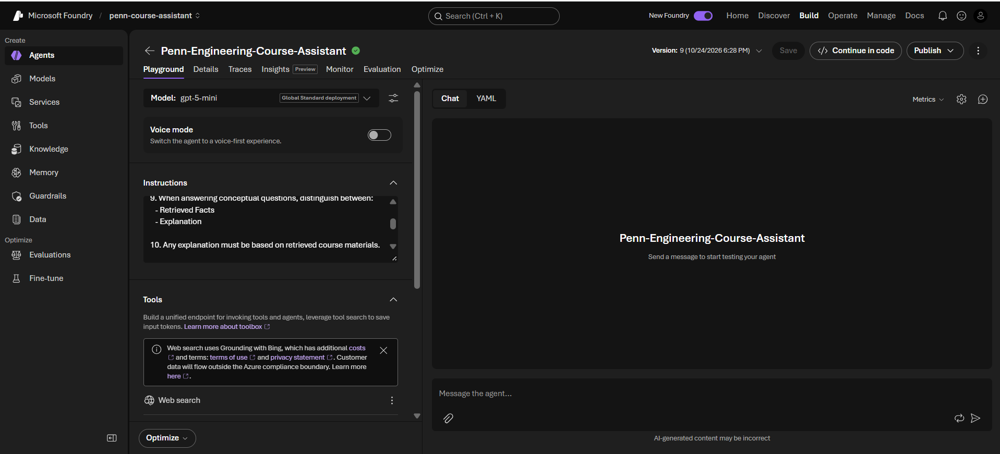
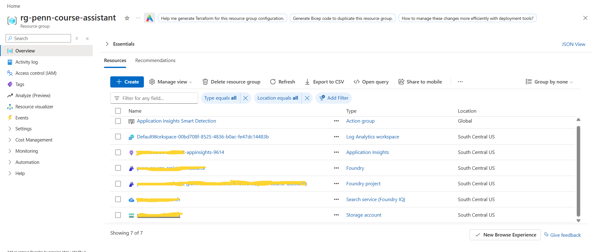
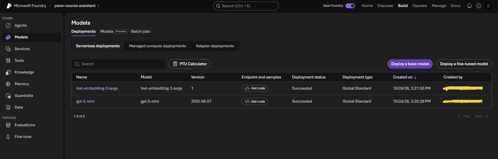
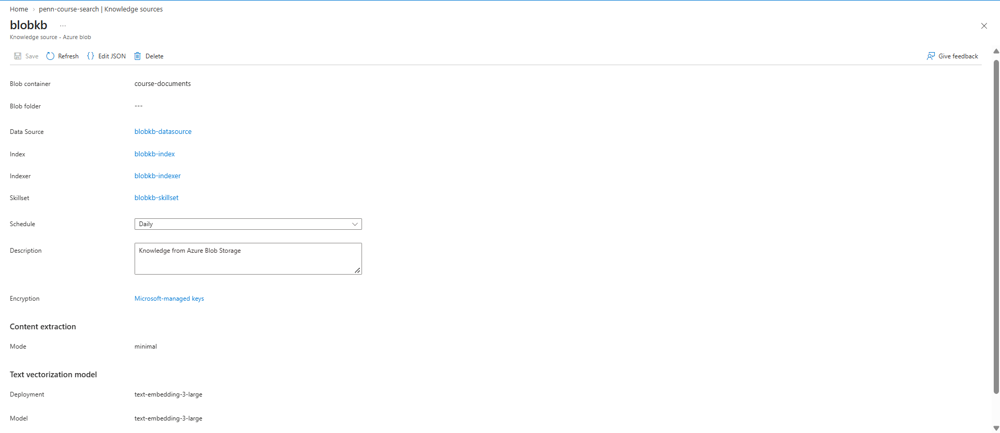
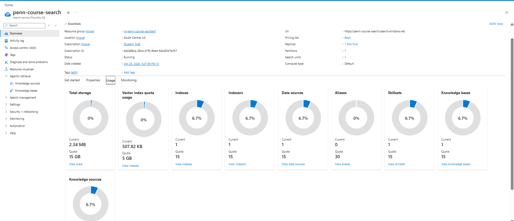
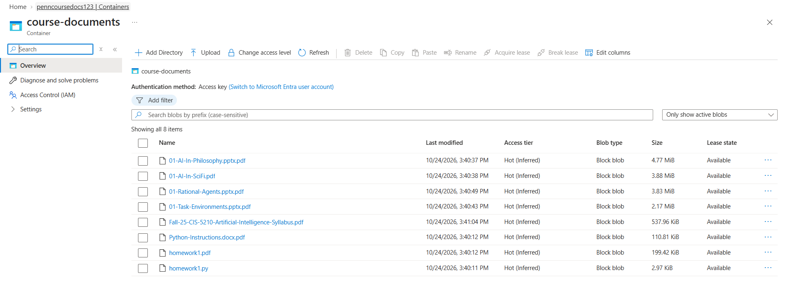
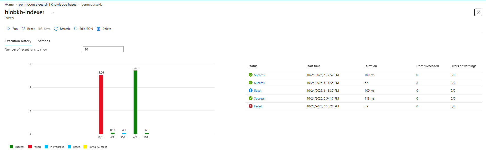
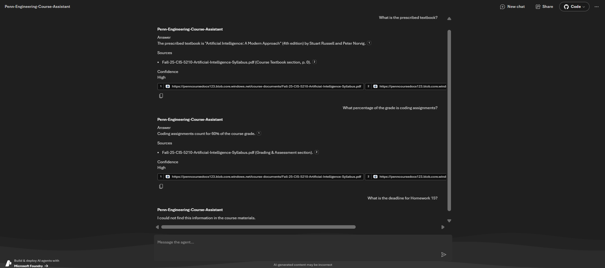
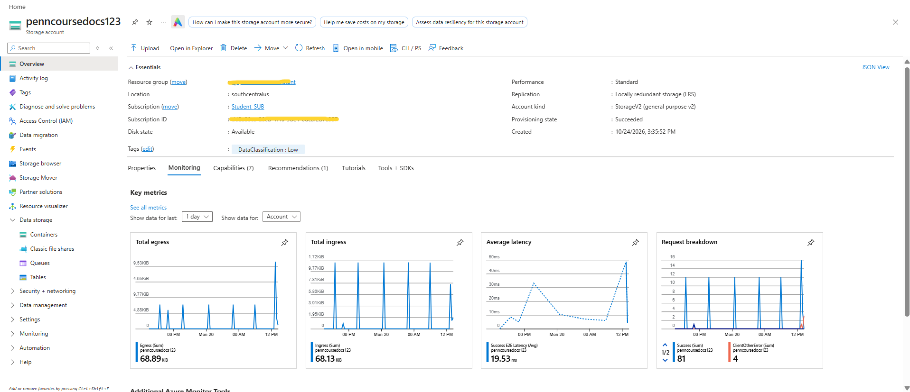

# 🎓 Penn Engineering AI Course Assistant

<div align="center">

[//]: # (https://img.shields.io/badge/Azure-AI%20Foundry-0078D4?style=for-the-badge&logo=microsoftazure)

[//]: # (https://img.shields.io/badge/Azure-AI%20Search-0099CC?style=for-the-badge)

[//]: # (https://img.shields.io/badge/Azure-OpenAI-412991?style=for-the-badge)

[//]: # (https://img.shields.io/badge/RAG-Retrieval--Augmented--Generation-green?style=for-the-badge)

[//]: # (https://img.shields.io/badge/GPT-5%20Mini-Powered-orange?style=for-the-badge)

### An AI-powered academic assistant built using Azure AI Foundry, Azure AI Search, and Azure OpenAI

</div>

---

## 📖 Overview

The **Penn Engineering AI Course Assistant** is a Retrieval-Augmented Generation (RAG) application designed to help students, teaching assistants, and instructors quickly find information from course materials using natural language.

Rather than relying solely on a large language model's internal knowledge, the assistant retrieves relevant information from official course documents and generates grounded responses with citations.

This approach minimizes hallucinations and ensures that answers are based on actual course materials.





---

## 🎯 Project Goals

✅ Answer questions using official course documents

✅ Provide source citations

✅ Support conversational interactions

✅ Reduce hallucinations through grounded retrieval

✅ Enable semantic search over course materials

✅ Assist students with coursework and exam preparation

✅ Support teaching staff with policy and rubric lookup

---

## 👥 Target Users

### Students

- Understand lecture concepts
- Clarify assignment requirements
- Review course policies
- Generate study guides

### Teaching Assistants

- Locate grading criteria
- Review assignment specifications
- Reference policies
- Compare requirements across assignments

### Instructors

- Quickly search course materials
- Verify syllabus details
- Review lecture content
- Access course resources efficiently

---

# 📂 Supported Course Content

The assistant indexes and retrieves information from:

- 📚 Course Syllabus
- 📄 Homework Specifications
- 📊 Lecture Slides
- 📝 Lecture Notes
- 💻 Programming Assignments
- ✅ Grading Rubrics
- 📖 Project Instructions
- 📋 Discussion Handouts
- 🎯 Exam Review Guides
- ❓ FAQs

---

# 🏗 Solution Architecture

```text
                        ┌────────────────────┐
                        │      Student       │
                        │        TA          │
                        │    Instructor      │
                        └─────────┬──────────┘
                                  │
                                  ▼
                    ┌───────────────────────────┐
                    │ Penn Engineering Assistant│
                    │     Azure AI Foundry      │
                    └─────────────┬─────────────┘
                                  │
                                  ▼
                         GPT-5 Mini Agent
                                  │
                                  ▼
                        Knowledge Base (RAG)
                                  │
                                  ▼
                         Azure AI Search
                                  │
             ┌────────────────────┴────────────────────┐
             ▼                                         ▼
       Vector Search                           Semantic Search
             │
             ▼
     text-embedding-3-large
             │
             ▼
      Azure Blob Storage
             │
             ▼
     Course Documents (PDFs)
```

---

# ⚙️ Technology Stack

## Microsoft Azure

| Service | Purpose |
|----------|----------|
| Azure AI Foundry | AI Agent Platform |
| Azure OpenAI | GPT-5 Mini & Embeddings |
| Azure AI Search | Vector & Semantic Retrieval |
| Azure Blob Storage | Document Storage |
| Foundry Knowledge Base | Grounded Retrieval Layer |

---

## Models Used



### Chat Model
```text
GPT-5 Mini
```
Used for:

- Question answering
- Response generation
- Multi-turn conversation

---

### Embedding Model


```text

text-embedding-3-large
```
Used for:

- Document embeddings
- Vector search
- Semantic retrieval

---

# 🔄 Data Flow

## Document Ingestion


```text
Upload Documents
        ↓
Azure Blob Storage
        ↓
Azure AI Search Indexer
        ↓
Chunk Documents
        ↓
Generate Embeddings
        ↓
Populate Search Index
```

---

## Question Answering

```text
User Question
        ↓
Convert Query to Embedding
        ↓
Vector + Semantic Search
        ↓
Retrieve Relevant Chunks
        ↓
GPT-5 Mini
        ↓
Grounded Answer + Citations
```

---

# 🧠 Key Features

## Retrieval-Augmented Generation (RAG)

Answers are grounded in uploaded course materials rather than generated solely from model knowledge.

---

## Semantic Search


Users can ask questions naturally:

```text
What is the prescribed textbook?
```

instead of searching for keywords.

---

## Source Attribution

Supporting sources.



---

## Hallucination Reduction

If information is unavailable, the assistant responds:

```text
I could not find this information in the course materials.
```

instead of inventing answers.

---

## Multi-Document Retrieval

The assistant can synthesize information across multiple documents while maintaining citations.

---

# 💡 Example Questions

### Syllabus Questions

```text
What percentage of the grade is homework?
```

```text
What is the prescribed textbook?
```

```text
What topics are covered in this course?
```

---

### Assignment Questions

```text
What are the requirements for Homework 1?
```

```text
What files must be submitted?
```

---

### Lecture Questions

```text
Summarize Lecture 1.
```

```text
Explain Rational Agents.
```

```text
What are PEAS components?
```

---

### Exam Preparation

```text
Create a study guide for the midterm.
```

```text
What concepts should I review?
```

---

# 🔒 Safety & Reliability

The assistant is designed to:

✅ Use retrieved course documents as the primary source of truth

✅ Cite supporting documents

✅ Reject unsupported answers

✅ Ignore prompt injection attempts in uploaded files

✅ Distinguish retrieved facts from generated explanations

✅ Prioritize accuracy over completeness

---

# 🛠 Challenges Encountered

## Azure OpenAI Embedding Authentication Failure

During development, document indexing repeatedly failed:

```text
AzureOpenAIEmbeddingSkill
Authentication Failed
```

### Root Cause

Azure AI Search could not authenticate to the Azure OpenAI embedding endpoint using its managed identity.

### Resolution

1. Enabled System Assigned Managed Identity for Azure AI Search.
2. Granted:

```text
Cognitive Services OpenAI User
```

role to the Azure AI Search managed identity.
3. Re-ran the indexer.
4. Successfully indexed all course documents.

Result:

```text
Documents Indexed: 8
Errors: 0
```


---

# 📊 Demonstrated Capabilities

### Grounded Question Answering

✅ Retrieves answers from official course documents

### Citation Generation

✅ Displays source document references

### Semantic Understanding

✅ Understands intent rather than relying solely on keywords

### Hallucination Mitigation

✅ Refuses to answer unsupported questions

### Vector Search

✅ Retrieves semantically related content

---

# 🚀 Future Enhancements

- [ ] Streamlit or React frontend
- [ ] Lecture summarization
- [ ] Auto-generated study guides
- [ ] Quiz generation
- [ ] Rubric analysis
- [ ] Exam review assistant
- [ ] Multi-course support
- [ ] Assignment deadline reminders

---

# 🎥 Project Demo

Example Queries & Response:





# 👨‍💻 Author

**Alan Philip**

Master of Applied Science in Computer Science
University of Pennsylvania

https://www.linkedin.com/in/alanphilip1998

Demo link: https://www.youtube.com/watch?v=Gcozc7iwwrM&list=PLX454XHhWCYw&index=2&t=258s

⭐ If you found this project interesting, please consider starring the repository.